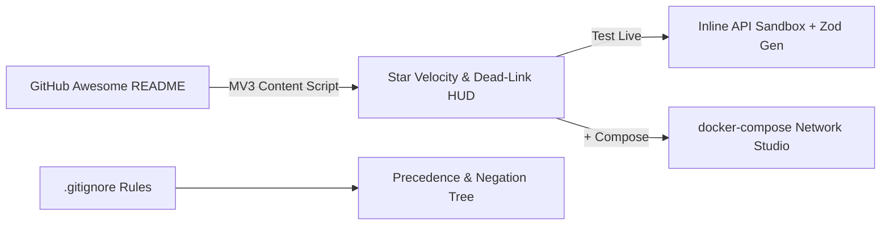

# list-radar

[](https://aetherx86.github.io/list-radar/)
[](plugin/manifest.json)
[](LICENSE)

> **GitHub List Intelligence Overlay, Inline API Sandbox, `docker-compose` Stack Composer & `.gitignore` Rule-Precedence Studio.**

## Covered Top-50 GitHub Ecosystems
| Ecosystem | Capability in `list-radar` |
| :--- | :--- |
| `awesome`, `awesome-python`, `awesome-go`, `HelloGitHub` | Live Chrome MV3 overlay injecting star-velocity sparklines, freshness badges, licenses & dead-link detection |
| `public-apis`, `free-programming-books`, `prompts.chat` | Inline API Sandbox with latency waterfall, JSON tree explorer, `fetch`/`curl` & Zod schema generation |
| `awesome-selfhosted`, `project-based-learning`, `secret-knowledge` | Multi-select container network diagrammer & production `docker-compose.yml` generator |
| `github/gitignore` | Interactive line-by-line `.gitignore` precedence & negation (`!pattern`) evaluator |

## 1-Step Plugin Install (Chrome Manifest V3)
1. Open `chrome://extensions` and enable **Developer mode**.
2. Click **Load unpacked** and select the `./plugin` directory.

## Architecture


## Quickstart
```bash
npm install && npm run dev
```
